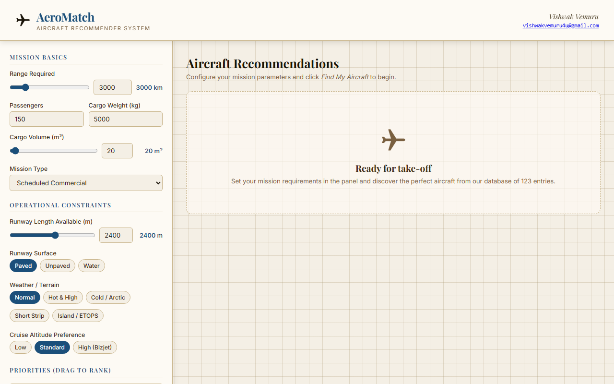

# AeroMatch - Aircraft Recommender

**Tell it your mission, get the right aircraft.** Set range, passengers, cargo, runway length and surface, weather and terrain, then rank your priorities. AeroMatch scores 123 aircraft and shows the best matches.

**[Try it live](https://vishwakvemuru.github.io/AeroMatch/)** - runs in your browser, nothing to install.

## Features
- 123 aircraft in the database, from airliners to bizjets
- Mission inputs: range, passengers, cargo weight and volume, mission type
- Operational limits: runway length and surface (paved, unpaved, water), hot-and-high, cold, short strip, island/ETOPS
- Drag-to-rank priorities
- Single static page: no server, no build step

## Run locally
Download the repo and open `AeroMatch_v3_with-images/aeromatch/index.html` in any browser.

## Versions
`AeroMatch_v1.html` and `AeroMatch_v2.html` are earlier single-file versions; v3 adds aircraft images.

> **Photos:** aircraft photos are gathered from the web and belong to their respective owners. They are included for educational, non-commercial use only. The MIT licence covers the code, not the photos. If you own a photo and want it removed, open an issue and it will be taken down.

## Related
[AeroCatalogue](https://github.com/VishwakVemuru/AeroCatalogue) | [Airfoil Bench](https://github.com/VishwakVemuru/Airfoil_Bench) | [Aircraft Classifier](https://github.com/VishwakVemuru/AircraftClassifier)

If this is useful, a star helps others find it.

Built by [Vishwak Vemuru](https://github.com/VishwakVemuru). MIT licence.
